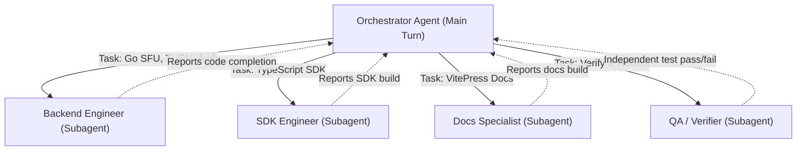

# AGENTS.md: Collaboration Guidelines & Agent System Architecture

## 1. Project Overview & Mission

**Connected** is an open-source, developer-friendly WebRTC video conferencing and real-time calling framework composed of:
1. **`server/`**: A self-contained, high-performance Go media server featuring an SFU (Selective Forwarding Unit using `pion/webrtc/v4`), embedded STUN/TURN server (`pion/turn/v3`) for zero-config NAT/firewall traversal, WebSocket signaling, pluggable authentication (HTTP webhook, CLI stdin/stdout, native JWT, or native Go interface), and Google Meet-style meeting permissions/moderation.
2. **`packages/core/`**: A lightweight, universal TypeScript client SDK (`@connected/core`) for browser and JS environments with clean reactive APIs for media, chat, reactions, and moderation.
3. **`docs/`**: A VitePress documentation suite configured for continuous deployment on GitHub Pages.
4. **`examples/`**: Working interactive demos and reference implementations.

---

## 2. Universal Standards

- **Language Policy**: All generated code, comments, documentation files, commit messages, and reports **MUST ALWAYS BE IN ENGLISH**, regardless of the user prompt language.
- **Strict Typing & Safety**:
  - Go: Concurrency must be thread-safe (`sync.RWMutex`, goroutines with clean cancellation contexts). Zero data races (`go test -race`).
  - TypeScript: Strict mode (`"strict": true`). No unchecked `any` types. Exported symbols must include full TSDoc annotations.
- **Dependency Discipline**:
  - Keep `@connected/core` free of heavy external UI or media dependencies; rely strictly on browser standard WebRTC and WebSocket APIs.
  - Keep `server/` self-contained with minimal production dependencies: `pion/webrtc/v4`, `pion/turn/v3`, `gorilla/websocket`, `golang-jwt/jwt/v5`.

---

## 3. Subagent System & Operational Roles

To maintain clean context windows and avoid cognitive bloat, tasks are distributed among specialized subagents:



### Role Definitions

| Role | Subagent Name | Primary Responsibilities |
| :--- | :--- | :--- |
| **Orchestrator** | `self` / Parent | Manages overall project state, updates `PROJECT_STATUS.md`, dispatches subagents, interacts with the user. |
| **Backend Engineer** | `backend-engineer` | Go SFU implementation, Pion WebRTC pipelines, embedded TURN server, auth providers, room session timers. |
| **SDK Engineer** | `sdk-engineer` | TypeScript `@connected/core`, local media capture, WebSocket signaling client, peer track subscriptions. |
| **Docs Specialist** | `docs-specialist` | VitePress setup, documentation guides, API reference docs, GitHub Pages deployment workflow. |
| **QA & Verifier** | `qa-verifier` | Independent code review, race condition detection, automated test execution, build checks, and edge-case verification. |

### Context Hygiene Rules for Agents
1. **Single Responsibility**: Each subagent must focus strictly on its assigned milestone or component.
2. **Concise Handshakes**: Subagents must report back high-level summaries of changes, test outputs, and issues discovered without dumping verbose terminal outputs or full file listings.
3. **Living Tracking**: Every major milestone transition must be recorded in `PROJECT_STATUS.md`.

---

## 4. Key Commands Reference

### Go Server (`server/`)
```bash
# Run all Go tests with race detector
cd server && go test -v -race ./...

# Build the standalone server binary
cd server && go build -o bin/connected-server cmd/server/main.go

# Run the server
cd server && ./bin/connected-server -config config.json
```

### TypeScript Packages (`packages/*`)
```bash
# Install monorepo dependencies
npm install

# Build all packages
npm run build

# Build core package specifically
npm run build --workspace=@connected/core

# Run type check
npm run typecheck
```

### Documentation (`docs/`)
```bash
# Start local VitePress development server
npm run docs:dev

# Build production static documentation (GitHub Pages)
npm run docs:build
```

---

## 5. Security & Networking Constraints

- **NAT Traversal**: The Go server must handle double NAT, symmetric NAT, and CGNAT by allocating dynamic or static TURN relay allocations through `pion/turn/v3`.
- **Remote Moderation Boundaries**: The server enforces that only users with the `host` or `co-host` role can dispatch moderation events (mute, kick, media stop, policy updates).
- **Privacy Enforcement**: Remote mute can force a client's audio track to stop sending or server-side silence it, but cannot force-unmute without user consent.

