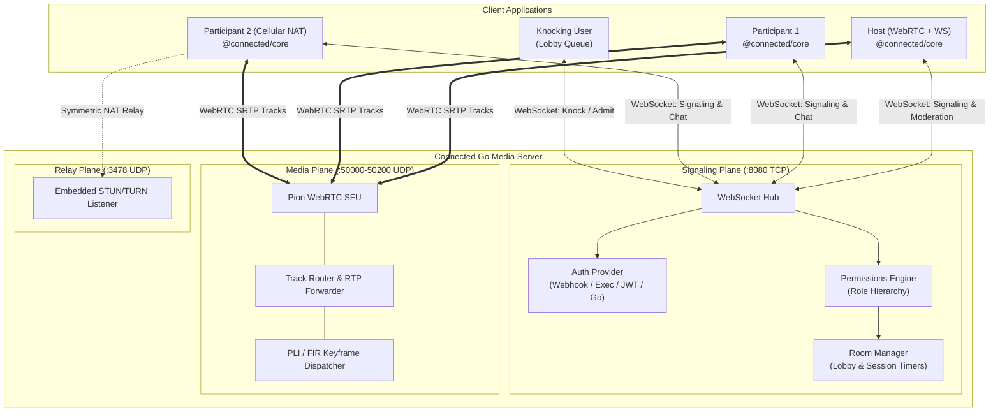

<p align="center">
  <a href="https://github.com/IsmaCortGtz/connected">
    
  </a>
</p>

<h3 align="center">Extensible WebRTC Video Conferencing & SFU Framework</h3>

<p align="center">
  A developer-friendly, self-contained WebRTC media server written in Go with an embedded STUN/TURN server, Google Meet-style meeting moderation & permissions, and a lightweight, universal TypeScript client SDK.
</p>

<p align="center">
  <a href="https://github.com/IsmaCortGtz/connected/actions"></a>
  <a href="https://www.npmjs.com/package/@connected/core"></a>
  <a href="https://pkg.go.dev/github.com/IsmaCortGtz/connected/server"></a>
  <a href="https://ismacortgtz.github.io/connected/"></a>
  <a href="https://github.com/IsmaCortGtz/connected/blob/main/LICENSE"></a>
</p>

---

## 🌟 Highlights & Capabilities

- ⚡ **High-Performance Go SFU**: Built on [Pion WebRTC v4](https://github.com/pion/webrtc), routing RTP packets with microsecond forwarding, dynamic keyframe (PLI/FIR) generation, and zero transcoding latency.
- 🌐 **Zero-Config Embedded STUN/TURN Server**: Built-in RFC 5766/8656 TURN UDP listener on port `3478` powered by [Pion TURN v3](https://github.com/pion/turn). Handles symmetric NATs, cellular 4G/5G, and corporate firewalls without external `coturn` dependencies.
- 🛡️ **4 Pluggable Authentication Modes**:
  1. **HTTP Webhook**: Delegates auth and permissions to external APIs (Auth0, Supabase, Laravel, Django, Next.js).
  2. **CLI Executable (`stdin`/`stdout`)**: Runs scripts in Python, Node, Bash, or Rust.
  3. **Native JWT**: Verifies signatures directly using `HS256`, `RS256`, or `ES256`.
  4. **Native Go Interface**: Embeds seamlessly into any custom Go backend by implementing `auth.Authenticator`.
- 👥 **Google Meet-Grade Moderation & Permissions**:
  - Waiting room / Lobby knocking & host admission.
  - Hierarchical roles: `host`, `co-host`, `participant`, and `viewer`.
  - Remote muting, camera locks, and screen sharing locks.
  - Synchronized session countdown timers with auto-expiration.
- 💻 **Complete Google Meet Flow Included**: Instant meeting IDs (`abc-defg-hij`), pre-join Green Room with camera/mic previews & device selectors, shareable URL routing (`?room=...`), in-call copy link pills, and post-call rejoin screens.
- 📦 **Universal TypeScript SDK (`@connected/core`)**: Pure browser WebRTC and WebSocket client with dual ESM/CJS bundles, strict typings, typed reactive events, and **zero external UI dependencies**.
- 🎙️ **Hardware A/V Lip-Sync & Ultra-Low Latency**: Hardware-synchronized audio/video streams, `playoutDelayHint = 0`, and jitter buffer targets set to 0.

---

## 🏗️ Architecture



---

## 🚀 Quick Start

### 1. Run the Go Media Server

#### Option A: Run Precompiled Binary
```bash
# Clone the repository
git clone https://github.com/IsmaCortGtz/connected.git
cd connected/server

# Build and run the server binary
go build -o bin/connected-server cmd/server/main.go
./bin/connected-server -config config.json
```

#### Option B: Run via Docker Compose
```bash
docker compose up -d
```

The server listens on:
- **`8080` (TCP)**: HTTP & WebSocket signaling endpoint (`ws://localhost:8080/ws`)
- **`3478` (UDP)**: Embedded STUN/TURN relay server
- **`50000-50200` (UDP)**: WebRTC media traffic (RTP / RTCP)

---

### 2. Connect with the TypeScript SDK (`@connected/core`)

Install the client SDK in your web application:

```bash
npm install @connected/core
```

Initialize a meeting with reactive media, chat, and moderation:

```typescript
import { ConnectedRoom } from '@connected/core';

// 1. Create a room instance
const room = new ConnectedRoom({ autoReconnect: true });

// 2. Listen to room and media events
room.on('connected', (info) => {
  console.log('Joined room as:', info.display_name, 'Role:', info.role);
});

room.on('trackSubscribed', (track, peer) => {
  if (track.kind === 'video') {
    const videoEl = document.getElementById(`video-${peer.id}`) as HTMLVideoElement;
    videoEl.srcObject = peer.stream;
  }
});

room.on('chatMessage', (msg) => {
  console.log(`[${msg.sender_name}]: ${msg.text}`);
});

room.on('reaction', (reaction) => {
  console.log(`${reaction.sender_name} reacted with ${reaction.emoji}`);
});

// 3. Join the meeting
await room.join({
  url: 'ws://localhost:8080/ws',
  roomId: 'eng-daily-standup',
  displayName: 'Alex Rivers',
  mediaOptions: {
    camera: true,
    microphone: true,
  },
});

// 4. In-call controls
await room.localParticipant.setMicrophoneMuted(true);
await room.localParticipant.startScreenShare();
await room.chat.sendMessage('Hello team!');
await room.reactions.sendReaction('👍');
```

---

### 3. Use the Go Server as an Embedded Library

You can embed the Connected media server directly into your existing Go application without running an external service:

```bash
go get github.com/IsmaCortGtz/connected/server
```

```go
package main

import (
	"log"
	"net/http"

	"github.com/IsmaCortGtz/connected/server/pkg/auth"
	"github.com/IsmaCortGtz/connected/server/pkg/config"
	"github.com/IsmaCortGtz/connected/server/pkg/room"
	"github.com/IsmaCortGtz/connected/server/pkg/sfu"
	"github.com/IsmaCortGtz/connected/server/pkg/signaling"
	"github.com/IsmaCortGtz/connected/server/pkg/turn"
)

func main() {
	cfg := config.DefaultConfig()

	// 1. Initialize embedded STUN/TURN relay
	turnServer, err := turn.NewServer(&cfg.Server.TURN)
	if err != nil {
		log.Fatalf("Failed to start TURN server: %v", err)
	}
	defer turnServer.Close()

	// 2. Initialize SFU and Room Manager
	sfuEngine, err := sfu.NewSFU(&cfg.Server)
	if err != nil {
		log.Fatalf("Failed to initialize SFU: %v", err)
	}

	authenticator := auth.NewAllowAllAuthenticator()
	roomManager := room.NewRoomManager(&cfg.Room)
	defer roomManager.Stop()

	// 3. Create WebSocket signaling hub
	hub := signaling.NewHub(roomManager, sfuEngine, authenticator, &cfg.Server, turnServer)

	http.HandleFunc("/ws", hub.HandleWebSocket)
	log.Println("Connected media server listening on :8080")
	log.Fatal(http.ListenAndServe(":8080", nil))
}
```

---

## 📦 Distribution & NPM Packaging

> [!NOTE]
> **What should be published to npm?**
>
> - **`@connected/core`** is the **only package** intended for npm distribution. It contains the universal TypeScript client SDK consumed by browser web apps, Electron, or mobile wrappers.
> - The Go media server is distributed via Go modules (`github.com/IsmaCortGtz/connected/server`), binary releases on GitHub, and Docker container images.
> - The example applications (`examples/*`) and documentation (`docs/`) are marked as private workspace packages.

---

## 🗂️ Repository Structure

```
connected/
├── server/                     # Go Media Server & SFU Core
│   ├── cmd/server/             # Standalone server CLI entrypoint
│   ├── pkg/sfu/                # Pion WebRTC SFU engine & RTP forwarding
│   ├── pkg/turn/               # Embedded RFC 5766/8656 STUN/TURN server
│   ├── pkg/signaling/          # WebSocket JSON signaling protocol & hub
│   ├── pkg/auth/               # Webhook, CLI Exec, JWT & Go auth providers
│   ├── pkg/room/               # Room lifecycle, lobby queues & session timers
│   ├── pkg/permissions/        # Roles & moderation rules (Host, Co-Host, etc.)
│   └── pkg/config/             # JSON configuration parser & env overrides
│
├── packages/
│   └── core/                   # @connected/core Universal TypeScript SDK
│       ├── src/room.ts         # Main ConnectedRoom orchestrator
│       ├── src/local-media.ts  # Camera, microphone & screen capture manager
│       ├── src/webrtc.ts       # RTCPeerConnection wrapper & perfect negotiation
│       ├── src/signaling.ts    # Resilient WebSocket client with auto-reconnect
│       └── src/moderation.ts   # Google Meet-style moderation controller
│
├── examples/
│   ├── demo-web/               # Full Google Meet-style browser web application
│   ├── custom-go-server/       # Reference embedded Go server extension
│   └── auth-webhook-node/      # Reference Node.js webhook authentication server
│
└── docs/                       # VitePress Documentation Suite (GitHub Pages)
```

---

## ⚙️ Configuration Reference (`config.json`)

```json
{
  "server": {
    "http_port": 8080,
    "udp_port_range_start": 50000,
    "udp_port_range_end": 50200,
    "public_ip": "auto",
    "turn": {
      "enabled": true,
      "port": 3478,
      "realm": "connected.local",
      "static_auth": {
        "username": "connected",
        "password": "connected_secret_turn_pass"
      }
    }
  },
  "room": {
    "default_max_participants": 50,
    "default_session_timeout_sec": 3600,
    "empty_room_ttl_sec": 60,
    "default_policies": {
      "allow_camera": true,
      "allow_mic": true,
      "allow_screen_share": true,
      "allow_chat": true,
      "allow_reactions": true,
      "require_lobby": false
    }
  },
  "auth": {
    "provider": "allow_all"
  }
}
```

Environment variable overrides are supported with the `CONNECTED_` prefix (e.g. `CONNECTED_SERVER_HTTP_PORT=9090`).

---

## 🧪 Testing & Verification

Run the comprehensive test suite across Go and TypeScript:

```bash
# Run all Go tests with race detection
cd server && go test -v -race ./...

# Run all TypeScript SDK unit tests
npm test

# Build all monorepo packages
npm run build

# Build production VitePress documentation
npm run docs:build
```

---

## 📄 License

This project is open-source software licensed under the **[MIT License](LICENSE)**.

Copyright © 2026 [Ismael Cortés](https://github.com/IsmaCortGtz) & Connected Contributors.

