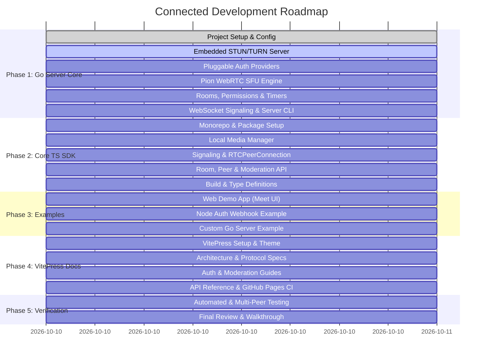

# Project Roadmap: Connected WebRTC Framework

## Milestone Overview

---

## Detailed Phases & Work Breakdown

### Phase 1: Go Media Server Core (`server/`)
- [ ] **1.1 Environment & Configuration Engine (`pkg/config`)**
  - Go module initialization with `pion/webrtc/v4`, `pion/turn/v3`, `gorilla/websocket`, `golang-jwt/jwt/v5`.
  - JSON configuration loader supporting defaults, custom paths, and environment variable overrides.
- [ ] **1.2 Embedded STUN / TURN Server (`pkg/turn`)**
  - Integrated UDP TURN listener using `pion/turn/v3`.
  - Dynamic/static credential generation for secure NAT traversal.
- [ ] **1.3 Pluggable Authentication System (`pkg/auth`)**
  - `Authenticator` interface.
  - HTTP Webhook provider (`POST` request with JSON response parser).
  - Executable process provider (pipes request to child process `stdin`, reads JSON `stdout`).
  - Native JWT provider (HMAC / RSA signature and claims verification).
- [ ] **1.4 Pion WebRTC SFU Media Engine (`pkg/sfu`)**
  - `RTCPeerConnection` lifecycle management.
  - Ingress: `TrackRemote` reading and dispatching.
  - Egress: `TrackLocalStaticRTP` creation and packet broadcasting to room subscribers.
  - RTCP Picture Loss Indication (PLI) forwarding for instant video synchronization.
- [ ] **1.5 Room Lifecycle, Permissions & Session Timers (`pkg/room`, `pkg/permissions`)**
  - Room registry with thread-safe participant tracking.
  - Role-based access control (`host`, `co-host`, `participant`, `viewer`).
  - Google Meet-style moderation: remote mute, camera toggle lock, screen-share lock, kick/ban, lobby admission.
  - Session timers: room expiration countdown, periodic broadcast warning, automatic shutdown.
- [ ] **1.6 WebSocket Signaling & Main CLI (`pkg/signaling`, `cmd/server/main.go`)**
  - Gorilla WebSocket connection upgrader.
  - JSON message routing: join, offer, answer, candidate, chat, reaction, moderation, timer events.
  - Server entrypoint binary with graceful shutdown handling.

---

### Phase 2: Core TypeScript SDK (`packages/core`)
- [ ] **2.1 Monorepo & Build Tooling**
  - Root `package.json` with npm workspaces.
  - `packages/core/package.json`, `tsconfig.json`, and `tsup.config.ts` (ESM, CJS, and browser bundles).
- [ ] **2.2 Local Media Manager (`src/local-media.ts`)**
  - Device enumeration (microphones, cameras, audio outputs).
  - Audio/video capture via `getUserMedia`.
  - Screen sharing capture via `getDisplayMedia`.
  - Track enabling/disabling, mute state tracking.
- [ ] **2.3 Signaling & WebRTC Client (`src/signaling.ts`, `src/webrtc.ts`)**
  - WebSocket client with exponential backoff reconnect.
  - Automatic SDP Offer/Answer negotiation and Trickle ICE candidate forwarding.
  - Subscription to remote tracks and HTML `<audio>` / `<video>` element binding helpers.
- [ ] **2.4 ConnectedRoom & Moderation API (`src/room.ts`, `src/moderation.ts`)**
  - Event-driven API (`on('participantJoined')`, `on('trackSubscribed')`, `on('chatMessage')`, etc.).
  - Host moderation functions (`muteParticipant()`, `kick()`, `admit()`, `setPolicies()`).
  - Chat and reaction dispatchers.

---

### Phase 3: Reference Examples (`examples/`)
- [ ] **3.1 Interactive Web Demo (`examples/demo-web`)**
  - Video grid layout supporting multiple participants.
  - Control bar: mic, camera, screen-share, hand raise, emoji reactions, chat panel, host settings.
- [ ] **3.2 Node.js Auth Webhook Example (`examples/auth-webhook-node`)**
  - Express/HTTP server demonstrating how a developer's backend validates room tokens.
- [ ] **3.3 Custom Go Server Example (`examples/custom-go-server`)**
  - Custom Go binary importing `github.com/.../connected/server/pkg` to show embedded native extension.

---

### Phase 4: VitePress Documentation Suite (`docs/`)
- [ ] **4.1 VitePress Configuration & Layout**
  - Custom branding, navigation bar, sidebars, and code themes.
- [ ] **4.2 Comprehensive Guides**
  - Getting Started (Go server quickstart, npm installation).
  - Architecture Deep-Dive (SFU mechanics, Pion WebRTC, embedded TURN, WebSocket signaling).
  - Authentication Integration Guide (HTTP Webhook, CLI Exec, JWT, Native Go).
  - Permissions & Moderation Guide (Google Meet features, roles, session timers).
  - Client SDK API Reference.
- [ ] **4.3 Deployment & CI**
  - Dockerfile and Docker Compose setup for the Go server.
  - GitHub Actions workflow (`.github/workflows/deploy-docs.yml`) for publishing to GitHub Pages.

---

### Phase 5: Verification & Walkthrough
- [ ] Automated Go test execution with race detector (`go test -v -race ./...`).
- [ ] TypeScript package build validation (`npm run build`).
- [ ] VitePress documentation build validation (`npm run docs:build`).
- [ ] Multi-peer simulation test and walkthrough documentation.

