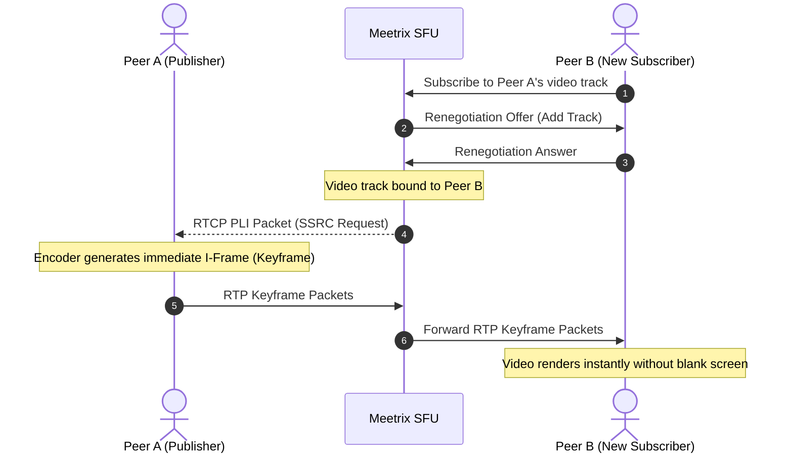
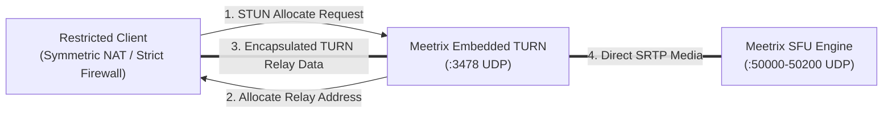
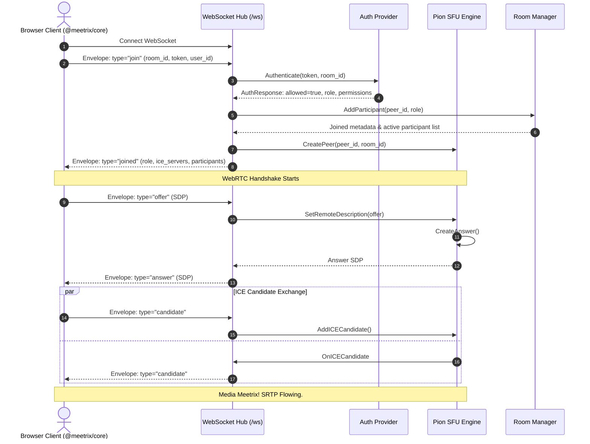

# Architecture & Media Plane

Meetrix decouples real-time communication into three distinct planes:
1. **Signaling Plane**: JSON envelopes transported over full-duplex WebSockets for session negotiation, room state, chat, reactions, and moderation.
2. **Media Plane**: High-throughput SRTP audio and video streams routed through a Go Selective Forwarding Unit (SFU) powered by Pion WebRTC v4.
3. **Relay Plane**: An embedded RFC 5766/8656 STUN and TURN UDP listener guaranteeing NAT and firewall traversal without third-party services.

---

## Architectural Planes

```mermaid
flowchart TB
    subgraph Clients["WebRTC Clients (@meetrix/core)"]
        ClientA["Peer A (Publisher & Subscriber)"]
        ClientB["Peer B (Subscriber)"]
    end

    subgraph Server["Meetrix Go Media Server"]
        subgraph SignalingPlane["Signaling Plane (:8080 TCP)"]
            WSHub["WebSocket Hub & Connection Pool"]
            RoomManager["Room State Manager"]
            PermEngine["Permissions & Moderation Engine"]
            AuthProvider["Pluggable Authenticator"]
        end

        subgraph MediaPlane["Media Plane (:50000-50200 UDP)"]
            Engine["Pion WebRTC Engine"]
            TrackRouter["Track Router & Forwarder"]
            PLISync["PLI Keyframe Generator"]
        end

        subgraph RelayPlane["Relay Plane (:3478 UDP)"]
            TURNServer["Embedded RFC 5766/8656 STUN/TURN Listener"]
        end
    end

    ClientA <-->|WebSocket: SDP & ICE| WSHub
    ClientB <-->|WebSocket: SDP & ICE| WSHub
    WSHub --> RoomManager
    RoomManager --> PermEngine
    RoomManager --> AuthProvider

    ClientA ==="1. Ingest SRTP (VP8 / Opus)"===> Engine
    Engine --> TrackRouter
    TrackRouter ===="2. Fan-out SRTP (Opus / VP8)"====> ClientB
    ClientB -.->|"3. RTCP PLI (Picture Loss Indication)"| PLISync
    PLISync -.->|"4. SSRC Keyframe Request"| ClientA

    ClientA -.->|"STUN / TURN UDP Relay"| TURNServer
    ClientB -.->|"STUN / TURN UDP Relay"| TURNServer
```

---

## 1. The Media Plane (Pion WebRTC SFU)

The media plane is implemented in `server/pkg/sfu` utilizing [Pion WebRTC v4](https://github.com/pion/webrtc).

### Ingestion & Track Wrapping (`OnTrack`)

When a client initiates media publication, it adds local audio or video tracks to its browser `RTCPeerConnection`. The browser negotiates the track via an SDP offer/answer exchange with the Go SFU.

Upon receipt on the server:
1. Pion fires the `pc.OnTrack` event with an incoming `webrtc.TrackRemote`.
2. The SFU instantiates an outgoing `webrtc.TrackLocalStaticRTP` configured with the exact codec capabilities (e.g., VP8 or Opus), Stream ID, and Track ID of the remote track.
3. Both tracks are bundled into an internal `PublishedTrack` structure and registered in the room's track catalog.

```go
localTrack, err := webrtc.NewTrackLocalStaticRTP(
    remoteTrack.Codec().RTPCodecCapability,
    remoteTrack.ID(),
    remoteTrack.StreamID(),
)
```

### Zero-Copy Packet Forwarding Loop

To maintain maximum throughput and minimal CPU overhead, Meetrix forwards incoming RTP packets directly to the local static track without decoding:

```go
go func() {
    for {
        select {
        case <-pubTrack.stopChan:
            return
        case <-p.closeChan:
            return
        default:
        }

        pkt, _, err := remoteTrack.ReadRTP()
        if err != nil {
            return
        }

        if err := localTrack.WriteRTP(pkt); err != nil && err != io.EOF {
            return
        }
    }
}()
```

Because media frames are neither decoded nor re-encoded, the server incurs no transcoding latency, achieving near-wire speed forwarding (~0.5 ms processing overhead per packet).

### Picture Loss Indication (PLI) Keyframe Synchronization

In video codecs like VP8 and H.264, video frames are categorized as:
- **I-Frames (Keyframes)**: Self-contained complete images.
- **P-Frames / B-Frames (Delta Frames)**: Incremental differences relative to previous frames.

When a new participant (Peer B) joins an ongoing room where Peer A is already publishing video:
1. Peer B receives delta frames that depend on past keyframes that Peer B never received.
2. Without intervention, Peer B's video decoder would freeze or render gray corruption for up to 10–30 seconds until the encoder naturally sends a periodic keyframe.
3. **Meetrix resolves this immediately**:
   - In `Peer.Subscribe()`, the SFU immediately dispatches an RTCP Picture Loss Indication (`rtcp.PictureLossIndication`) to the publisher's SSRC:
     ```go
     if pubTrack.Kind == webrtc.RTPCodecTypeVideo && publisher != nil {
         _ = publisher.SendPLI(pubTrack.SSRC)
     }
     ```
   - In addition, the SFU continuously listens to incoming RTCP packets from subscribers on `sender.ReadRTCP()`. When packet loss occurs on the subscriber's downlink, any received PLI packet is relayed directly back to the publisher.



### Dynamic Port Allocation

In production container environments (Docker, Kubernetes), opening tens of thousands of UDP ports can cause port exhaustion and firewall complexity. Meetrix lets operators strictly bound the ephemeral WebRTC media ports via `webrtc_port_min` and `webrtc_port_max` (defaults: `50000` to `50200`):

```json
{
  "server": {
    "webrtc_port_min": 50000,
    "webrtc_port_max": 50200
  }
}
```

Pion's `SettingEngine.SetEphemeralUDPPortRange` enforces that every client ICE candidate and SRTP socket allocates exclusively within this range.

---

## 2. The Relay Plane (Embedded STUN/TURN)

Meetrix includes an embedded STUN and TURN server built directly into the binary using Pion's TURN package:
- Listens on UDP port `3478` (configurable via `turn.port`).
- Authenticates clients using long-term shared credentials (`turn.users` and `turn.secret`).
- Seamlessly resolves NAT 1:1 address translation by rewriting external ICE candidates to the configured `public_ip`.



When a peer successfully authenticates via WebSocket, the server automatically appends the embedded TURN relay to the `ice_servers` array returned in the `joined` message payload.

---

## 3. The Signaling Plane (WebSockets)

The signaling plane manages the lifecycle of room memberships, session timers, and real-time messaging over a single persistent WebSocket connection per client at `/ws`.

### Clean Envelope Protocol

All messages exchanged between the client and server share a standardized JSON envelope:

```json
{
  "type": "string",
  "payload": {}
}
```

### Full Join Negotiation Flow



---

## 4. Concurrency & Thread Safety Model

Meetrix utilizes Go's idiomatic concurrency primitives to guarantee leak-free operation:
- **Locking Granularity**: Every `Room`, `Peer`, and `Participant` protects its local maps with a `sync.RWMutex`. High-frequency reads (inspecting track lists, querying roles) acquire read locks (`RLock`), while state changes (adding tracks, muting) acquire write locks (`Lock`).
- **Clean Goroutine Teardown**: Each `PublishedTrack` and `Peer` maintains dedicated `stopChan` and `closeChan` channels. When a peer disconnects or leaves, a `sync.Once` guard terminates all forwarding goroutines and closes the underlying Pion `PeerConnection`.
- **Non-blocking Signaling**: WebSocket write queues buffer outbound envelopes to prevent a slow consumer from blocking room-wide broadcasts.
