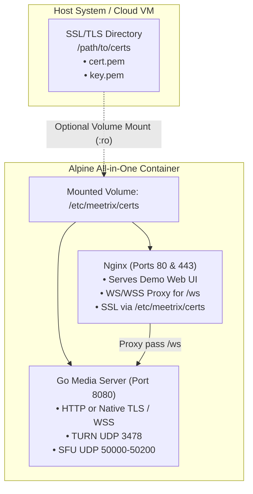

# Production Deployment

Deploying WebRTC media infrastructure in production requires careful handling of UDP port routing, network address translation (NAT), firewall traversal, and WebSocket proxies. This guide provides turnkey deployment templates and best practices.

---

## Network Architecture & Ports

Meetrix requires specific ports open on your host or cloud security group:


### Port Allocation Reference

| Port | Protocol | Service | Description |
| :--- | :---: | :--- | :--- |
| **`443`** | TCP | Reverse Proxy | HTTPS & secure WebSocket (`wss://`) ingress |
| **`8080`** | TCP | Meetrix Server | Internal HTTP and WebSocket signaling listener |
| **`3478`** | UDP | Embedded TURN/STUN | RFC 5766/8656 UDP relay listener for symmetric NATs |
| **`50000-50200`** | UDP | Pion WebRTC SFU | Ephemeral media ports for RTP audio/video streams |

---

## NAT 1:1 & Public IP Configuration

WebRTC clients determine connection paths via ICE candidates. When running on cloud providers (AWS EC2, Google Cloud Compute, DigitalOcean, Hetzner), the host operating system typically binds to a private RFC 1918 IP address (e.g., `10.0.0.5`), while external clients must reach the public IPv4 address (e.g., `203.0.113.10`).

In `server/config.json`:

```json
{
  "server": {
    "public_ip": "203.0.113.10",
    "webrtc_port_min": 50000,
    "webrtc_port_max": 50200
  }
}
```

Or via environment variable:

```bash
export MEETRIX_PUBLIC_IP="203.0.113.10"
```

> [!IMPORTANT]
> If `public_ip` is left as `"auto"`, Meetrix attempts to discover its public IP via STUN during startup. For production deployments with static IPs, **always set an explicit public IP** to avoid lookup latency during startup.

---

## Docker Container Images

Meetrix provides two production-ready container images based on **Alpine Linux**:

1. **All-in-One Container (`Dockerfile`)**: Bundles the Go Media Server, embedded STUN/TURN server, Nginx reverse proxy, and the interactive Google Meet-style Demo Web application.
2. **Standalone Media Server Container (`Dockerfile.server`)**: A lean, headless container containing strictly the Go Media Server (Pion WebRTC SFU, TURN, and WebSocket signaling), ideal for custom frontend architectures and microservice topologies.

---

### Flexible TLS Modes: With or Without HTTPS

Both Docker images support running with or without HTTPS (TLS certificates) via the `MEETRIX_TLS_ENABLED` environment variable:

| Mode | `MEETRIX_TLS_ENABLED` | Behavior | Ideal For |
| :--- | :---: | :--- | :--- |
| **Automatic** *(Default)* | `auto` | Detects certificates in `/etc/meetrix/certs`. If valid certificates exist (`cert.pem`, `fullchain.pem`, or `tls.crt`), enables HTTPS. If no certificates are mounted, runs in plain HTTP mode. | Zero-config local development, testing, and production |
| **Strict HTTPS** | `true` | Enforces HTTPS on both Go server and Nginx. If no mounted certificate is found, automatically generates a self-signed fallback certificate so the container never fails to boot. | Staging, standalone HTTPS servers, and direct browser access |
| **Plain HTTP** | `false` | Explicitly disables TLS. The Go server listens on HTTP and Nginx serves the web app on port 80. | Deployments behind external reverse proxies (Cloudflare, Traefik, AWS ALB, Caddy, Kubernetes Ingress) |

> [!NOTE]
> Modern web browsers restrict `navigator.mediaDevices.getUserMedia` (camera and microphone access) to **secure contexts** (`https://` or `http://localhost`). When testing over plain HTTP on remote networks or external domains, ensure you terminate SSL at an upstream ingress proxy or enable TLS mode.

### Dual HTTPS Architecture & Certificate Mount Point

When TLS is active, both **Nginx** and the **Go Media Server** share a single standardized certificate volume mount point:

- **Mount Directory**: `/etc/meetrix/certs`
- **Certificate File**: `/etc/meetrix/certs/cert.pem` (or `fullchain.pem`, `tls.crt`)
- **Private Key File**: `/etc/meetrix/certs/key.pem` (or `privkey.pem`, `tls.key`)



---

## 1. All-in-One Image (`Dockerfile`)

The root `Dockerfile` builds the Go media server, compiles the TypeScript SDK and demo web application, and packages them with Nginx:

```bash
# Build the All-in-One image
docker build -t meetrix:latest .

# Run in HTTP mode (zero config)
docker run -d --name meetrix -p 80:80 -p 8080:8080 -p 3478:3478/udp -p 50000-50200:50000-50200/udp meetrix:latest

# Run in HTTPS mode with mounted SSL certificates
docker run -d --name meetrix \
  -v /opt/meetrix/certs:/etc/meetrix/certs:ro \
  -p 80:80 -p 443:443 -p 8080:8080 -p 3478:3478/udp -p 50000-50200:50000-50200/udp \
  meetrix:latest
```

---

## 2. Standalone Media Server Image (`Dockerfile.server`)

For production setups where your frontend is hosted separately (e.g. Next.js, Vue, mobile apps) or behind an external API gateway, use `Dockerfile.server`:

```bash
# Build from repository root
docker build -f Dockerfile.server -t meetrix-server:latest .

# Or build from server/ directory
cd server && docker build -t meetrix-server:latest .

# Run in HTTP mode
docker run -d --name meetrix-server \
  -p 8080:8080/tcp -p 3478:3478/udp -p 50000-50200:50000-50200/udp \
  meetrix-server:latest

# Run in HTTPS mode with mounted SSL certificates
docker run -d --name meetrix-server \
  -v /opt/meetrix/certs:/etc/meetrix/certs:ro \
  -p 8080:8080/tcp -p 3478:3478/udp -p 50000-50200:50000-50200/udp \
  meetrix-server:latest
```

---

## Publishing to GitHub Container Registry (GHCR)

You can push your image to **GitHub Packages (GHCR)** so it can be deployed via Portainer or any Docker environment.

### 1. Authenticate with GitHub Container Registry

Generate a **Personal Access Token (classic)** with `write:packages`, `read:packages`, and `delete:packages` scopes at [GitHub Settings > Developer settings > Tokens](https://github.com/settings/tokens).

Log in locally:

```bash
export CR_PAT="YOUR_GITHUB_PERSONAL_ACCESS_TOKEN"
echo $CR_PAT | docker login ghcr.io -u YOUR_GITHUB_USERNAME --password-stdin
```

### 2. Build, Tag, and Push

```bash
# Build the Alpine image
docker build -t ghcr.io/YOUR_GITHUB_USERNAME/meetrix:latest .

# Push image to GitHub Container Registry
docker push ghcr.io/YOUR_GITHUB_USERNAME/meetrix:latest
```

### 3. Automated GitHub Actions Workflow

This repository includes `.github/workflows/docker-publish.yml` which automatically builds multi-architecture images (`linux/amd64`, `linux/arm64`) and pushes to GHCR whenever changes are pushed to `main` or release tags:

```yaml
name: Build and Publish Docker Images

on:
  push:
    branches: [main]
    tags: ['v*.*.*']
  workflow_dispatch:

env:
  REGISTRY: ghcr.io
  IMAGE_NAME: ${{ github.repository }}

jobs:
  build-and-push:
    runs-on: ubuntu-24.04-arm
    permissions:
      contents: read
      packages: write
    strategy:
      fail-fast: false
      matrix:
        include:
          - target: all-in-one
            image_suffix: ""
            dockerfile: ./Dockerfile
          - target: server
            image_suffix: "-server"
            dockerfile: ./Dockerfile.server
    steps:
      - uses: actions/checkout@v4
      - uses: docker/setup-buildx-action@v3
      - uses: docker/login-action@v3
        with:
          registry: ${{ env.REGISTRY }}
          username: ${{ github.actor }}
          password: ${{ secrets.GITHUB_TOKEN }}
      - uses: docker/metadata-action@v5
        id: meta
        with:
          images: ${{ env.REGISTRY }}/${{ env.IMAGE_NAME }}${{ matrix.image_suffix }}
          tags: |
            type=raw,value=latest,enable=${{ github.ref == 'refs/heads/main' }}
            type=semver,pattern={{version}}
      - uses: docker/build-push-action@v6
        with:
          context: .
          file: ${{ matrix.dockerfile }}
          push: true
          platforms: linux/arm64
          tags: ${{ steps.meta.outputs.tags }}
          labels: ${{ steps.meta.outputs.labels }}
          cache-from: type=gha,scope=${{ matrix.target }}
          cache-to: type=gha,mode=max,scope=${{ matrix.target }}
```

### 4. Public vs Private Package Visibility

By default, newly published packages on GHCR are **private**. To allow Portainer to pull the image without authentication:
1. Go to your GitHub profile or organization -> **Packages**.
2. Click on **`meetrix`**.
3. Under **Package settings**, scroll down to **Danger Zone** -> **Change package visibility** and set it to **Public**.

> [!NOTE]
> If you prefer keeping the image private, add GitHub Container Registry credentials in Portainer: **Registries** > **Add registry** > select **Custom registry** > Name: `ghcr.io`, URL: `ghcr.io`, Username: your GitHub username, Password: Personal Access Token.

---

## Portainer & Docker Compose Deployment

In **Portainer**:
1. Open your Portainer dashboard and select your environment.
2. In the left menu, click **Stacks** -> **Add stack**.
3. Name the stack: `meetrix`.
4. In the **Web editor**, paste one of the Docker Compose configurations below.
5. Click **Deploy the stack**.

### `docker-compose.yml` (Host Network Mode - Recommended for Linux)

Host network mode eliminates Docker NAT overhead for UDP media packets and gives the best WebRTC performance:

```yaml
version: '3.8'

services:
  meetrix:
    image: ghcr.io/YOUR_GITHUB_USERNAME/meetrix:latest
    container_name: meetrix
    network_mode: "host"
    restart: unless-stopped
    environment:
      - MEETRIX_HTTP_PORT=8080
      - MEETRIX_PUBLIC_IP=203.0.113.10  # Replace with your public IP or domain
      - MEETRIX_WEBRTC_PORT_MIN=50000
      - MEETRIX_WEBRTC_PORT_MAX=50200
      - MEETRIX_TURN_ENABLED=true
      - MEETRIX_TURN_PORT=3478
      - MEETRIX_TURN_SECRET=your-secret-turn-token
      - MEETRIX_AUTH_PROVIDER=allow_all  # Options: allow_all, jwt, webhook, exec
    volumes:
      # Mount directory containing cert.pem and key.pem (or fullchain.pem/privkey.pem)
      - /opt/meetrix/certs:/etc/meetrix/certs:ro
```

### `docker-compose.yml` (Bridge Mode Alternative with Port Mapping)

If your host environment does not allow `network_mode: "host"` (such as macOS/Windows or restricted container environments):

```yaml
version: '3.8'

services:
  meetrix:
    image: ghcr.io/YOUR_GITHUB_USERNAME/meetrix:latest
    container_name: meetrix
    restart: unless-stopped
    ports:
      - "80:80/tcp"                 # HTTP (redirects to HTTPS)
      - "443:443/tcp"               # HTTPS (Nginx Demo Web & WebSocket Proxy)
      - "8080:8080/tcp"             # Meetrix Go Media Server Direct HTTPS/WSS
      - "3478:3478/udp"             # Embedded STUN/TURN Server
      - "50000-50200:50000-50200/udp" # WebRTC SFU Media RTP Ports
    environment:
      - MEETRIX_PUBLIC_IP=203.0.113.10  # Replace with your public IP or domain
      - MEETRIX_WEBRTC_PORT_MIN=50000
      - MEETRIX_WEBRTC_PORT_MAX=50200
      - MEETRIX_TURN_ENABLED=true
      - MEETRIX_TURN_PORT=3478
      - MEETRIX_TURN_SECRET=your-secret-turn-token
      - MEETRIX_AUTH_PROVIDER=allow_all
    volumes:
      # Mount directory containing cert.pem and key.pem
      - /opt/meetrix/certs:/etc/meetrix/certs:ro
```

---

## Reverse Proxy Configuration

In production, place an HTTPS reverse proxy in front of the HTTP port (`8080`) to provide TLS termination, SSL certificates, and WebSocket protocol upgrades.

### Nginx Configuration

```nginx
# /etc/nginx/sites-available/meetrix.conf

map $http_upgrade $connection_upgrade {
    default upgrade;
    ''      close;
}

server {
    listen 80;
    server_name meet.example.com;
    return 301 https://$host$request_uri;
}

server {
    listen 443 ssl http2;
    server_name meet.example.com;

    ssl_certificate /etc/letsencrypt/live/meet.example.com/fullchain.pem;
    ssl_certificate_key /etc/letsencrypt/live/meet.example.com/privkey.pem;

    # Signaling WebSocket Endpoint
    location /ws {
        proxy_pass http://127.0.0.1:8080;
        proxy_http_version 1.1;
        proxy_set_header Upgrade $http_upgrade;
        proxy_set_header Connection $connection_upgrade;
        proxy_set_header Host $host;
        proxy_set_header X-Real-IP $remote_addr;
        proxy_set_header X-Forwarded-For $proxy_add_x_forwarded_for;
        proxy_set_header X-Forwarded-Proto $scheme;

        # Keepalive timeouts for long-running calls
        proxy_read_timeout 86400s;
        proxy_send_timeout 86400s;
    }

    # Static Web Client or Health Checks
    location / {
        proxy_pass http://127.0.0.1:8080;
        proxy_set_header Host $host;
        proxy_set_header X-Real-IP $remote_addr;
    }
}
```

### Caddyfile (Automatic SSL)

```nginx
meet.example.com {
    reverse_proxy /ws 127.0.0.1:8080 {
        header_up Host {host}
        header_up X-Real-IP {remote_host}
    }

    reverse_proxy /* 127.0.0.1:8080
}
```

---

## Firewall Rules (`ufw` / `iptables`)

```bash
# Allow SSH
sudo ufw allow 22/tcp

# Allow Web & Signaling
sudo ufw allow 80/tcp
sudo ufw allow 443/tcp

# Allow Embedded STUN / TURN Relay
sudo ufw allow 3478/udp

# Allow WebRTC Ephemeral Media Ports
sudo ufw allow 50000:50200/udp

# Enable firewall
sudo ufw enable
```

---

## Operating System Performance Tuning

Under high concurrency (hundreds of participants sending 50-100 RTP packets/second), the Linux network stack requires increased socket buffer sizes to avoid UDP packet drops.

Add the following to `/etc/sysctl.conf`:

```ini
# Maximum socket receive buffer size (32MB)
net.core.rmem_max = 33554432

# Maximum socket send buffer size (32MB)
net.core.wmem_max = 33554432

# Default socket buffers
net.core.rmem_default = 262144
net.core.wmem_default = 262144

# Maximum number of packets queued on the input side
net.core.netdev_max_backlog = 10000
```

Apply immediately:

```bash
sudo sysctl -p
```

Also verify open file descriptors in `/etc/security/limits.conf`:

```text
* soft nofile 65535
* hard nofile 65535
```
