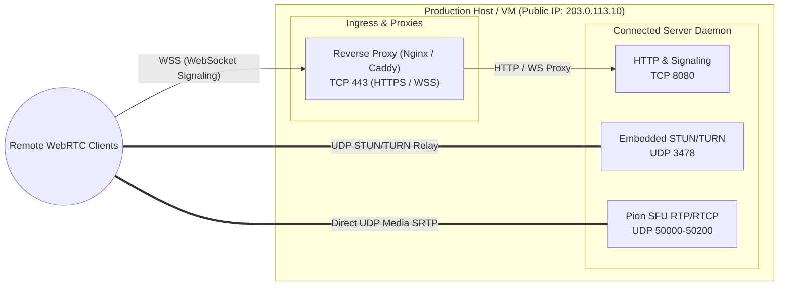

# Production Deployment

Deploying WebRTC media infrastructure in production requires careful handling of UDP port routing, network address translation (NAT), firewall traversal, and WebSocket proxies. This guide provides turnkey deployment templates and best practices.

---

## Network Architecture & Ports

Connected requires specific ports open on your host or cloud security group:



### Port Allocation Reference

| Port | Protocol | Service | Description |
| :--- | :---: | :--- | :--- |
| **`443`** | TCP | Reverse Proxy | HTTPS & secure WebSocket (`wss://`) ingress |
| **`8080`** | TCP | Connected Server | Internal HTTP and WebSocket signaling listener |
| **`3478`** | UDP | Embedded TURN/STUN | RFC 5766/8656 UDP relay listener for symmetric NATs |
| **`50000-50200`** | UDP | Pion WebRTC SFU | Ephemeral media ports for RTP audio/video streams |

---

## NAT 1:1 & Public IP Configuration

WebRTC clients determine connection paths via ICE candidates. When running on cloud providers (AWS EC2, Google Cloud Compute, DigitalOcean, Hetzner), the host operating system typically binds to a private RFC 1918 IP address (e.g., `10.0.0.5`), while external clients must reach the public IPv4 address (e.g., `203.0.113.10`).

In `server/config.json`:

```json
{
  "server": {
    "public_ip": "203.0.113.10",
    "webrtc_port_min": 50000,
    "webrtc_port_max": 50200
  }
}
```

Or via environment variable:

```bash
export CONNECTED_PUBLIC_IP="203.0.113.10"
```

> [!IMPORTANT]
> If `public_ip` is left as `"auto"`, Connected attempts to discover its public IP via STUN during startup. For production deployments with static IPs, **always set an explicit public IP** to avoid lookup latency during startup.

---

## Production Dockerfile

Use a multi-stage Dockerfile to build a minimal, hardened container image.

Create `server/Dockerfile`:

```dockerfile
# Stage 1: Build binary
FROM golang:1.24-alpine AS builder

WORKDIR /build

# Install git and build dependencies
RUN apk add --no-cache git ca-certificates tzdata

COPY go.mod go.sum ./
RUN go mod download

COPY . .
RUN CGO_ENABLED=0 GOOS=linux GOARCH=amd64 go build \
    -ldflags="-w -s" \
    -o connected-server \
    ./cmd/server

# Stage 2: Hardened runtime
FROM alpine:3.20

WORKDIR /app

RUN apk --no-cache add ca-certificates tzdata

# Create unprivileged user
RUN adduser -D -u 10001 connecteduser

COPY --from=builder /build/connected-server /app/connected-server
COPY config.json /app/config.json

USER connecteduser

EXPOSE 8080/tcp 3478/udp 50000-50200/udp

ENTRYPOINT ["/app/connected-server", "-config", "/app/config.json"]
```

---

## Docker Compose Deployment

Because WebRTC requires high-throughput UDP packet delivery without Docker NAT translation overhead, **using `network_mode: host` on Linux is strongly recommended**.

### `docker-compose.yml` (Host Network Mode - Recommended)

```yaml
version: '3.8'

services:
  connected:
    build:
      context: ./server
      dockerfile: Dockerfile
    network_mode: "host"
    restart: unless-stopped
    environment:
      - CONNECTED_HTTP_PORT=8080
      - CONNECTED_PUBLIC_IP=203.0.113.10
      - CONNECTED_WEBRTC_PORT_MIN=50000
      - CONNECTED_WEBRTC_PORT_MAX=50200
      - CONNECTED_TURN_ENABLED=true
      - CONNECTED_TURN_PORT=3478
      - CONNECTED_TURN_SECRET=change-this-in-production-turn-secret
      - CONNECTED_AUTH_PROVIDER=jwt
      - CONNECTED_AUTH_JWT_SECRET=change-this-production-jwt-secret-min-32-bytes
    volumes:
      - ./server/config.json:/app/config.json:ro
```

### `docker-compose.yml` (Bridge Mode Alternative)

If host networking cannot be used (e.g., Docker for Mac/Windows during development):

```yaml
version: '3.8'

services:
  connected:
    build:
      context: ./server
      dockerfile: Dockerfile
    ports:
      - "8080:8080/tcp"
      - "3478:3478/udp"
      - "50000-50200:50000-50200/udp"
    restart: unless-stopped
    environment:
      - CONNECTED_PUBLIC_IP=127.0.0.1
```

---

## Reverse Proxy Configuration

In production, place an HTTPS reverse proxy in front of the HTTP port (`8080`) to provide TLS termination, SSL certificates, and WebSocket protocol upgrades.

### Nginx Configuration

```nginx
# /etc/nginx/sites-available/connected.conf

map $http_upgrade $connection_upgrade {
    default upgrade;
    ''      close;
}

server {
    listen 80;
    server_name meet.example.com;
    return 301 https://$host$request_uri;
}

server {
    listen 443 ssl http2;
    server_name meet.example.com;

    ssl_certificate /etc/letsencrypt/live/meet.example.com/fullchain.pem;
    ssl_certificate_key /etc/letsencrypt/live/meet.example.com/privkey.pem;

    # Signaling WebSocket Endpoint
    location /ws {
        proxy_pass http://127.0.0.1:8080;
        proxy_http_version 1.1;
        proxy_set_header Upgrade $http_upgrade;
        proxy_set_header Connection $connection_upgrade;
        proxy_set_header Host $host;
        proxy_set_header X-Real-IP $remote_addr;
        proxy_set_header X-Forwarded-For $proxy_add_x_forwarded_for;
        proxy_set_header X-Forwarded-Proto $scheme;

        # Keepalive timeouts for long-running calls
        proxy_read_timeout 86400s;
        proxy_send_timeout 86400s;
    }

    # Static Web Client or Health Checks
    location / {
        proxy_pass http://127.0.0.1:8080;
        proxy_set_header Host $host;
        proxy_set_header X-Real-IP $remote_addr;
    }
}
```

### Caddyfile (Automatic SSL)

```nginx
meet.example.com {
    reverse_proxy /ws 127.0.0.1:8080 {
        header_up Host {host}
        header_up X-Real-IP {remote_host}
    }

    reverse_proxy /* 127.0.0.1:8080
}
```

---

## Firewall Rules (`ufw` / `iptables`)

```bash
# Allow SSH
sudo ufw allow 22/tcp

# Allow Web & Signaling
sudo ufw allow 80/tcp
sudo ufw allow 443/tcp

# Allow Embedded STUN / TURN Relay
sudo ufw allow 3478/udp

# Allow WebRTC Ephemeral Media Ports
sudo ufw allow 50000:50200/udp

# Enable firewall
sudo ufw enable
```

---

## Operating System Performance Tuning

Under high concurrency (hundreds of participants sending 50-100 RTP packets/second), the Linux network stack requires increased socket buffer sizes to avoid UDP packet drops.

Add the following to `/etc/sysctl.conf`:

```ini
# Maximum socket receive buffer size (32MB)
net.core.rmem_max = 33554432

# Maximum socket send buffer size (32MB)
net.core.wmem_max = 33554432

# Default socket buffers
net.core.rmem_default = 262144
net.core.wmem_default = 262144

# Maximum number of packets queued on the input side
net.core.netdev_max_backlog = 10000
```

Apply immediately:

```bash
sudo sysctl -p
```

Also verify open file descriptors in `/etc/security/limits.conf`:

```text
* soft nofile 65535
* hard nofile 65535
```
