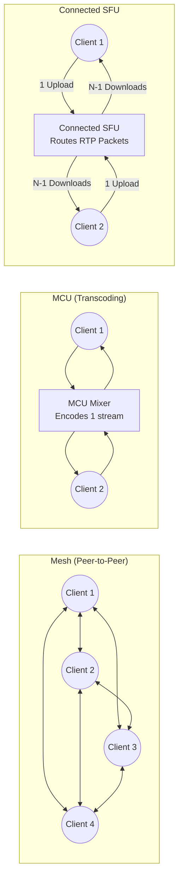
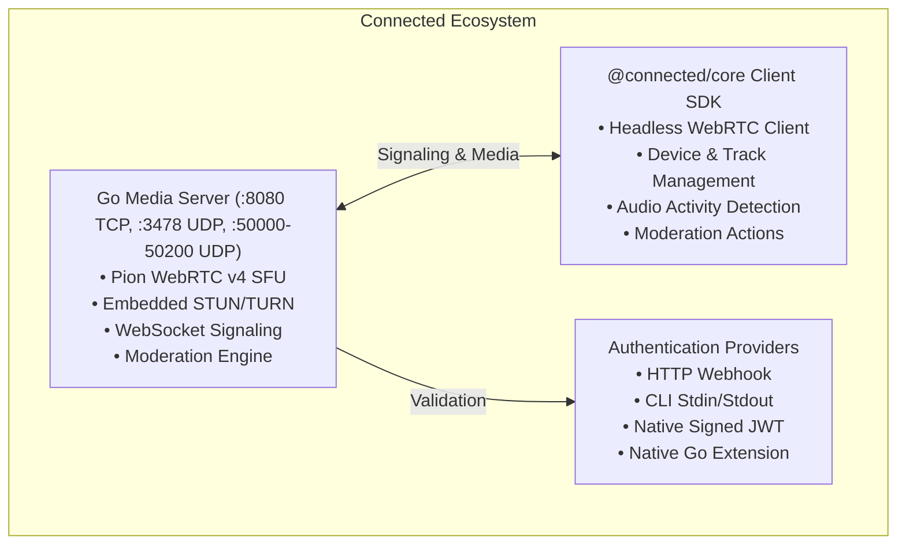

# Introduction to Connected

**Connected** is an extensible, self-hostable WebRTC video conferencing framework and Selective Forwarding Unit (SFU) written in Go, paired with a modern, zero-dependency TypeScript client SDK (`@connected/core`).

It is engineered for teams building interactive video communication platforms—such as video meeting suites, virtual classrooms, telehealth consultations, and remote collaboration tools—without the complexity of proprietary cloud lock-in or managing sprawling WebRTC infrastructure.

---

## Key Capabilities

- **High-Performance Go Media Core**: Built on [Pion WebRTC v4](https://github.com/pion/webrtc), delivering concurrent track routing, deterministic memory utilization, and native Go goroutine scaling.
- **Embedded RFC 5766/8656 STUN & TURN Relay**: Built directly into the media server daemon on UDP port `3478`. Eliminates external coturn daemons and simplifies NAT traversal.
- **4 Pluggable Authentication Modes**: Seamlessly integrates with existing user directories using HTTP Webhooks, CLI executables (`stdin/stdout`), native signed JWTs, or embedded Go interfaces.
- **Google Meet-Style Moderation Engine**: Native support for participant roles (`host`, `co-host`, `participant`, `viewer`), waiting room knocking/admitting, remote mute/stop-media, room policy locks, and session countdown timers.
- **Universal TypeScript Client SDK**: `@connected/core` provides a headless, strictly typed API for managing devices, local tracks, remote peer states, real-time chat, and emoji reactions.
- **Turnkey Production Deployment**: Ready-to-run Docker and Docker Compose configurations, NAT 1:1 address handling, and reverse proxy templates for Nginx and Caddy.

---

## Why SFU vs. Mesh P2P?

When architecting multi-party WebRTC applications, there are three primary topologies: **Mesh (Peer-to-Peer)**, **MCU (Multipoint Control Unit)**, and **SFU (Selective Forwarding Unit)**.

### The Limits of Mesh P2P

In a full mesh topology, every participant establishes a direct peer-to-peer connection with every other participant:
- **Bandwidth Scaling**: For $N$ participants, each client must encode and upload $N - 1$ media streams. Total connections across the room scale as $O(N^2)$.
- **Upstream Bottleneck**: Most consumer internet connections are asymmetric (e.g., 50 Mbps down / 5 Mbps up). A mesh call degrades significantly after 4–5 participants due to client uplink exhaustion.
- **Client CPU Exhaustion**: Encoding multiple concurrent VP8/H.264 video streams rapidly throttles client devices and drains battery life on mobile.

### Why MCU is Often Impractical

An MCU server decodes incoming video from all participants, stitches them into a composite video grid, and re-encodes a single stream back to each participant. While this minimizes client bandwidth ($O(1)$), it requires massive GPU or CPU compute clusters on the server and introduces noticeable transcoding latency (100–300 ms).

### Why Connected Uses an SFU

Connected implements a **Selective Forwarding Unit**:
1. **$O(N)$ Bandwidth on Clients**: Each client encodes and uploads **exactly one** audio and video stream to the server. The server duplicates and forwards RTP packets to the other $N - 1$ peers.
2. **Sub-Millisecond Packet Forwarding**: Connected inspects and routes RTP packets at layer 4 without decoding or re-encoding media frames, achieving near-zero server-side latency.
3. **Bandwidth Optimization**: Clients receive individual streams, allowing responsive UI layouts (e.g., pinning an active speaker or hiding off-screen video).
4. **Adaptive Keyframe Sync**: Connected intercepts Picture Loss Indication (PLI) feedback and requests keyframes from senders on-demand when new participants subscribe.

---

## Why Embedded STUN and TURN?

Real-world WebRTC connections frequently traverse symmetric NATs, carrier-grade NATs (CGNAT), and restrictive enterprise firewalls. Without a TURN relay, up to 15–20% of peer connections fail to connect.

Traditionally, deploying WebRTC requires managing an auxiliary `coturn` server alongside the media server:
- Separate configuration files, user databases, and secret keys.
- Complex orchestration and port synchronization across two independent software systems.
- Fragile credential exchange between the application server and the TURN daemon.

**Connected embeds an RFC 5766 / RFC 8656 TURN UDP relay directly into the Go server process on port `3478`:**

- **Unified Configuration**: Media limits, authentication credentials, and TURN secrets reside in a single `config.json` or set of environment variables.
- **Seamless ICE Exchange**: When a peer connects over WebSocket, the server automatically issues matching ICE server configuration containing the server's public IP and embedded TURN credentials.
- **Zero Additional Daemons**: Eliminates the operational footprint of running, monitoring, and updating external relay software.

---

## Ecosystem Overview

Connected consists of three decoupled components:

1. **`server/`**: The Go SFU media engine. Manages room state, participant lifecycle, packet routing, permissions, and STUN/TURN relays.
2. **`packages/core`**: The `@connected/core` TypeScript library. Provides high-level abstractions for browser video conferencing without dictating any UI framework (works with React, Vue, Svelte, or vanilla JS).
3. **`examples/`**: Ready-to-run reference implementations showcasing custom authenticators, embedded servers, and web applications.

---

## Next Steps

- Follow the [Quickstart Guide](/guide/quickstart) to spin up your local server and join your first call.
- Explore the [Architecture & Media Plane](/guide/architecture) for details on Pion WebRTC routing and PLI keyframe handling.
- Review [Authentication Modes](/guide/authentication) to secure rooms with Webhooks or JWTs.
