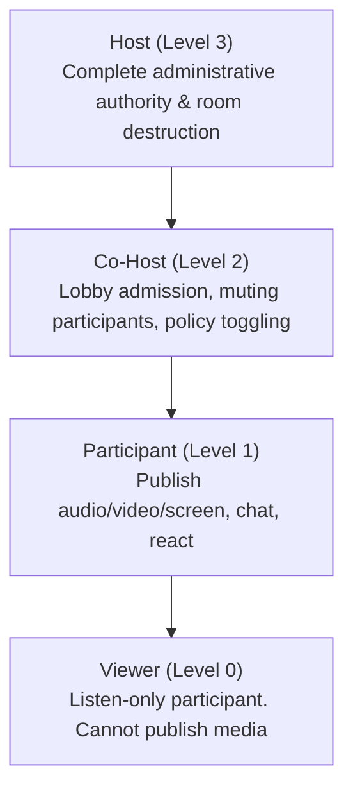
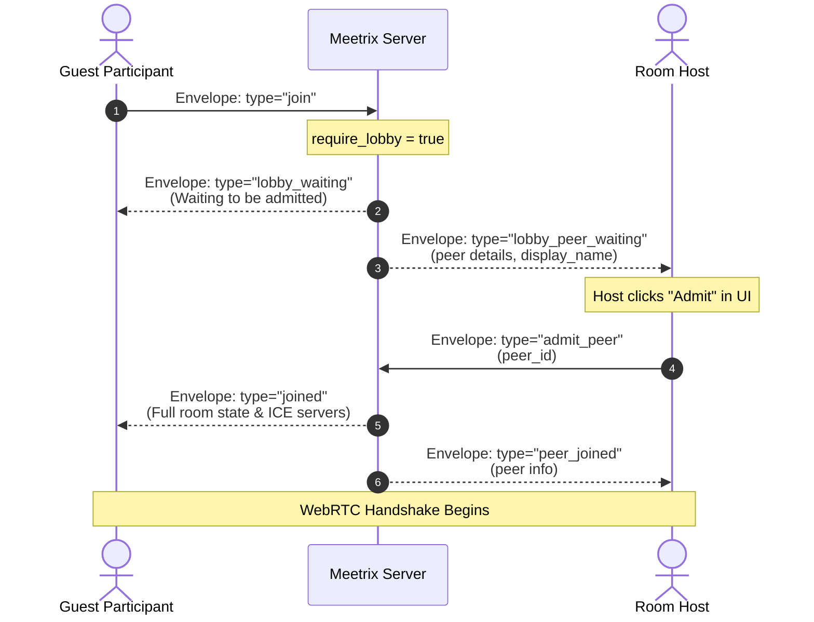

# Permissions & Moderation

Meetrix provides Google Meet-style hierarchical moderation and participant management out of the box. Hosts can manage large-scale conference calls with granular media permissions, waiting room knock-to-enter flows, remote muting, and session countdown timers.

---

## Role Hierarchy Model

Every participant in a Meetrix room is assigned exactly one role:



### Hierarchy Enforcement Rule

Administrative actions (such as muting, stopping screen share, or kicking) can **only be performed on participants strictly lower in the hierarchy**.
- A **Host** can moderate Co-Hosts, Participants, and Viewers.
- A **Co-Host** can moderate Participants and Viewers, but **cannot** moderate fellow Co-Hosts or the Host.
- **Participants** and **Viewers** cannot moderate anyone.

### Capability Matrix

| Capability | Host | Co-Host | Participant | Viewer |
| :--- | :---: | :---: | :---: | :---: |
| **Publish Audio / Video** | Yes | Yes | Yes (if room policy allows) | No |
| **Screen Sharing** | Yes | Yes | Yes (if room policy allows) | No |
| **Send Chat & Reactions** | Yes | Yes | Yes (if room policy allows) | Yes (if policy allows) |
| **Bypass Room Media Locks** | Yes | Yes | No | No |
| **Admit Peers from Lobby** | Yes | Yes | No | No |
| **Update Room Policies** | Yes | Yes | No | No |
| **Remote Mute (Audio/Video)** | Yes | Yes | No | No |
| **Stop Remote Media (Screen)** | Yes | Yes | No | No |
| **Kick Participant** | Yes | Yes | No | No |
| **End Room for All** | Yes | No | No | No |

---

## Waiting Room / Lobby System

When `require_lobby: true` is enabled in `RoomPolicy`, incoming participants do not enter the active media room immediately. Instead, they enter a waiting lobby until a host or co-host admits them.



### Client SDK Lobby Handling

```typescript
import { MeetrixRoom } from '@meetrix/core';

const room = new MeetrixRoom();

// 1. Participant knocks and waits in lobby
room.on('lobbyWaiting', (message) => {
  console.log('Currently in lobby:', message);
  showWaitingSpinner();
});

// 2. Host receives notification of waiting peers
room.on('lobbyPeerWaiting', (peer) => {
  console.log(`Knock received from ${peer.display_name} (${peer.id})`);
  
  // Host UI displays an "Admit" button
  renderAdmitButton(peer.id, () => {
    room.moderation.admit(peer.id);
  });
});

// 3. When admitted, 'connected' fires automatically for the participant
room.on('connected', (payload) => {
  hideWaitingSpinner();
  console.log('Successfully admitted into meeting!');
});
```

---

## Remote Muting & Media Locks

Hosts and co-hosts can remotely disable participant media tracks and lock room-wide capabilities.

### Remote Mute

A host can mute another participant's microphone or camera:

```typescript
// Mute audio
room.moderation.mute(targetPeerId, 'audio');

// Mute camera
room.moderation.mute(targetPeerId, 'video');
```

When a participant is remotely muted:
1. The server notifies the target peer with a `peer_muted` envelope.
2. The `@meetrix/core` SDK automatically disables the corresponding local track.
3. All peers in the room receive the update to synchronize participant tile UI icons.

```typescript
room.on('moderationAction', (event) => {
  if (event.action === 'mute') {
    console.log(`Peer ${event.targetPeerId} was muted (${event.media}) by ${event.byPeerId}`);
  }
});
```

### Remote Stop Screen Share

If an unauthorized participant shares their screen, a host or co-host can immediately revoke the screen share:

```typescript
room.moderation.stopMedia(targetPeerId, 'screenshare');
```

The target peer's SDK invokes `LocalParticipant.stopScreenShare()`, unpublishes the track from Pion SFU, and terminates screen capture in the browser.

### Room-Wide Policy Locks

Hosts can toggle global restrictions across all standard participants at any time:

```typescript
// Disable all cameras and microphones room-wide
room.moderation.setRoomPolicies({
  allow_camera: false,
  allow_mic: false,
  allow_screen_share: false,
  allow_chat: true,
  allow_reactions: true,
  require_lobby: true,
});
```

All participants receive a `policyUpdated` event:

```typescript
room.on('policyUpdated', (newPolicy) => {
  if (!newPolicy.allow_camera) {
    showToast('The host has disabled cameras for this meeting.');
  }
});
```

> [!NOTE] Host Immunity
> Room-wide locks do **not** apply to Hosts or Co-Hosts. They retain the ability to publish media and share screens regardless of active room locks.

---

## Session Countdown Timers & TTL

To prevent unattended rooms from consuming cloud compute resources, Meetrix incorporates native session timers.

### Configuration

In `config.json`:

```json
{
  "room": {
    "default_session_timeout_sec": 3600,
    "empty_room_ttl_sec": 60
  }
}
```

- **`default_session_timeout_sec`**: Maximum duration (in seconds) a meeting can run before being closed automatically (e.g., 3600 = 60 minutes).
- **`empty_room_ttl_sec`**: How long (in seconds) a room persists in memory after the last participant departs before being destroyed.

### Real-Time Countdown Ticks

The server emits a `session_timer_tick` envelope every second to all connected participants:

```typescript
room.on('sessionTimerTick', (remainingSeconds) => {
  const minutes = Math.floor(remainingSeconds / 60);
  const seconds = remainingSeconds % 60;
  timerLabel.textContent = `${minutes}:${seconds < 10 ? '0' : ''}${seconds}`;

  if (remainingSeconds === 300) {
    showWarningToast('Warning: This call will end in 5 minutes.');
  }
});

room.on('sessionEnded', (reason) => {
  alert(`Call ended: ${reason}`);
  window.location.href = '/goodbye';
});
```

---

## Kicking Participants

Hosts and co-hosts can remove disruptive participants:

```typescript
room.moderation.kick(targetPeerId, 'Violated meeting conduct');
```

The kicked user immediately receives a `kicked` envelope, their WebRTC peer connection is closed, and their WebSocket connection is terminated.
