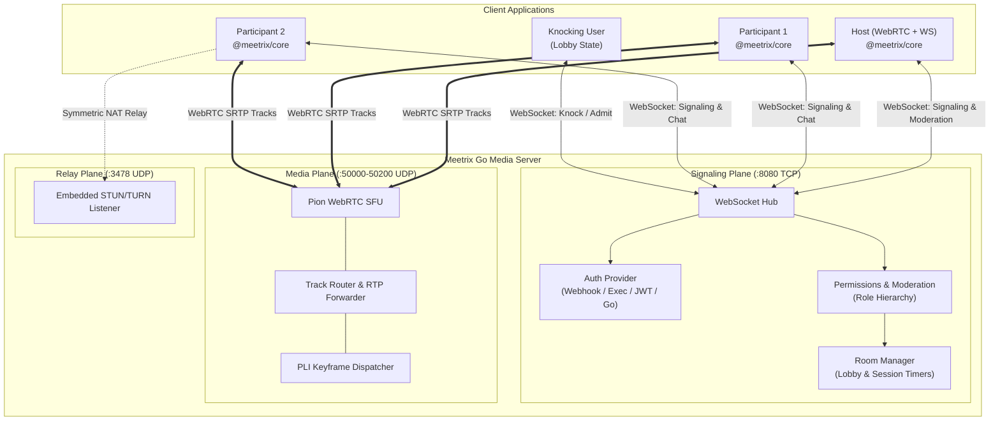

<div class="vp-doc" style="margin-top: 3rem;">

## High-Level Architecture



## Quick Installation

::: code-group

```bash [TypeScript SDK]
npm install @meetrix/core
```

```bash [Go Server Core]
git clone https://github.com/IsmaCortGtz/meetrix.git
cd meetrix/server
go build -o meetrix-server ./cmd/server
./meetrix-server -config config.json
```

```bash [Docker Compose]
docker compose up -d
```

:::

## Key Metrics & Capabilities

| Capability | Specification |
| :--- | :--- |
| **Media Plane Architecture** | Pion WebRTC v4 SFU (Selective Forwarding Unit) |
| **Relay Server** | Embedded RFC 5766/8656 STUN/TURN UDP listener on port `3478` |
| **Signaling Protocol** | Real-time WebSocket envelope protocol (`join`, `offer`, `answer`, `candidate`, `chat`, `moderation`) |
| **Authentication Providers** | HTTP Webhook, CLI executable `stdin/stdout`, Native JWT (`HS256`/`RS256`), Native Go interface |
| **Moderation Engine** | Google Meet-style Roles (`host`, `co-host`, `participant`, `viewer`), Waiting Lobby, Remote Mute, Policy Locks |
| **Client Core SDK** | `@meetrix/core` (Dual ESM/CJS, IIFE global, strict DTS typings, zero UI opinions) |
| **Port Allocation** | TCP `8080` (HTTP/Signaling), UDP `3478` (STUN/TURN), UDP `50000-50200` (WebRTC RTP/RTCP) |

</div>
